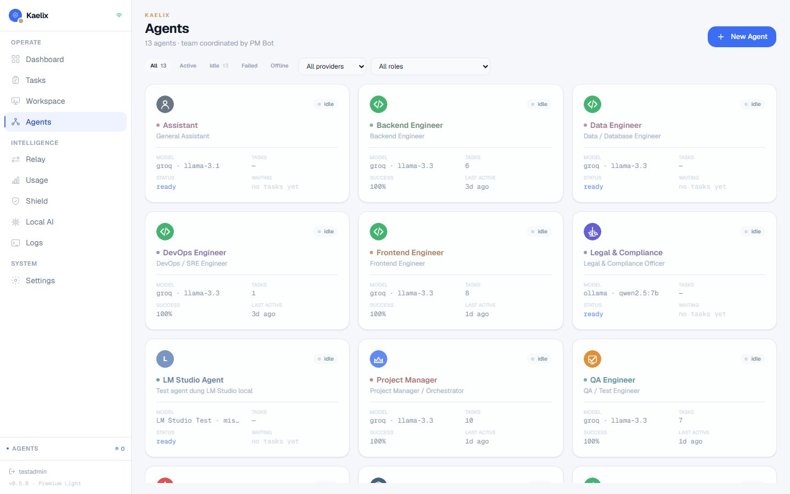
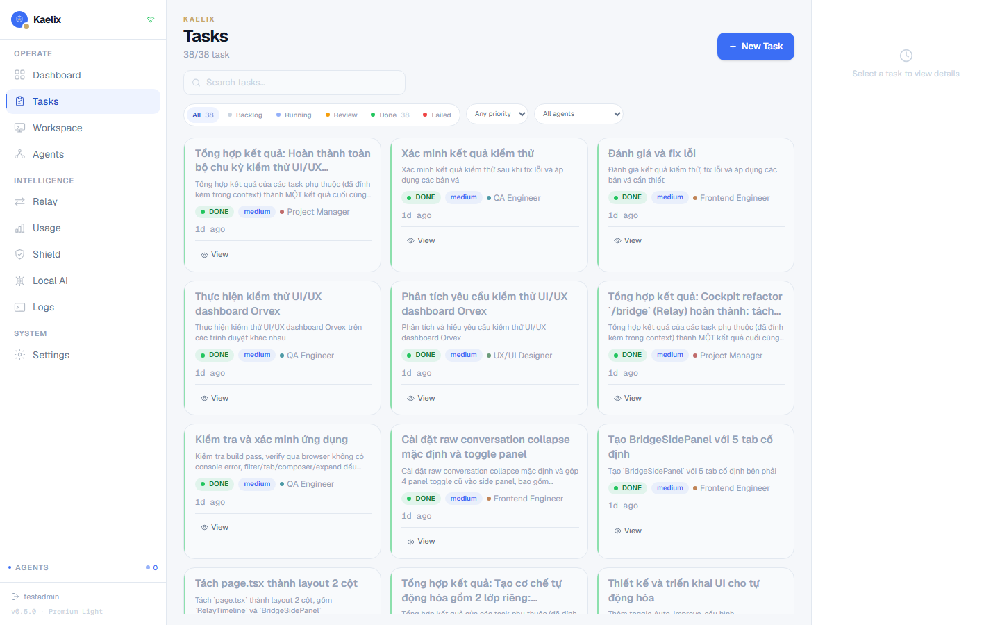
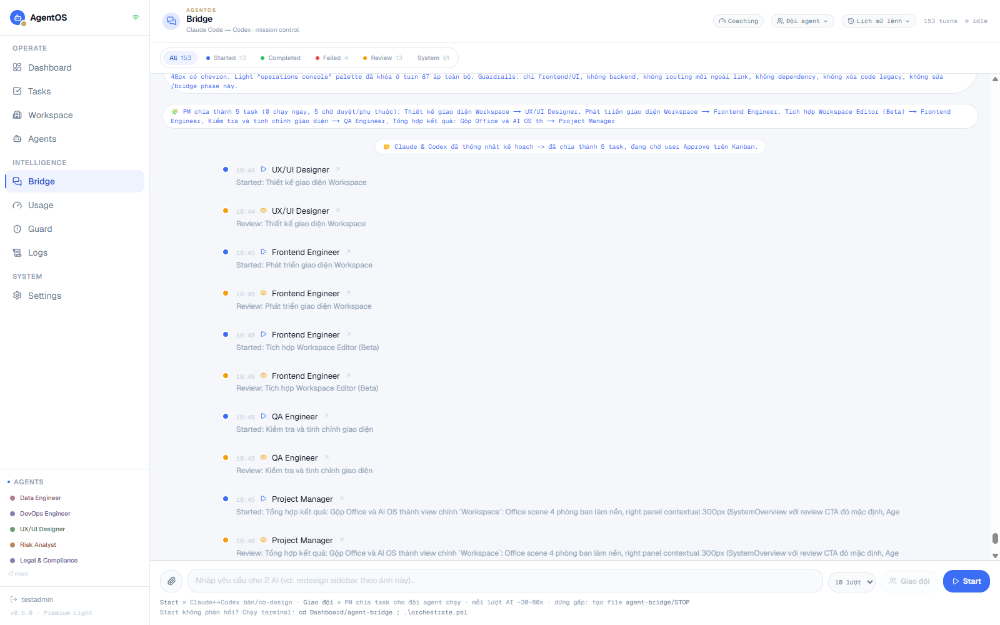
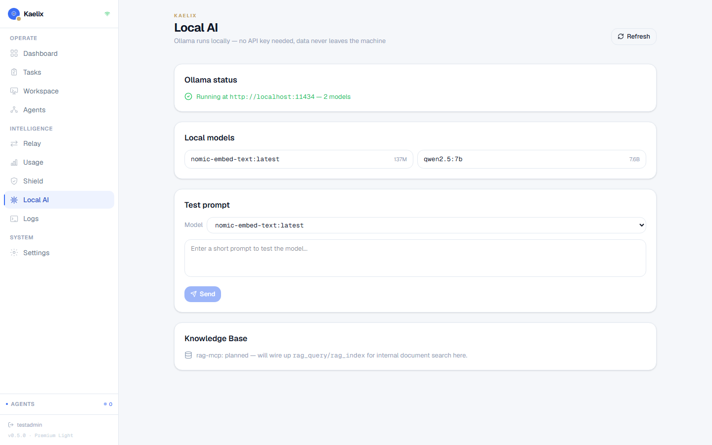
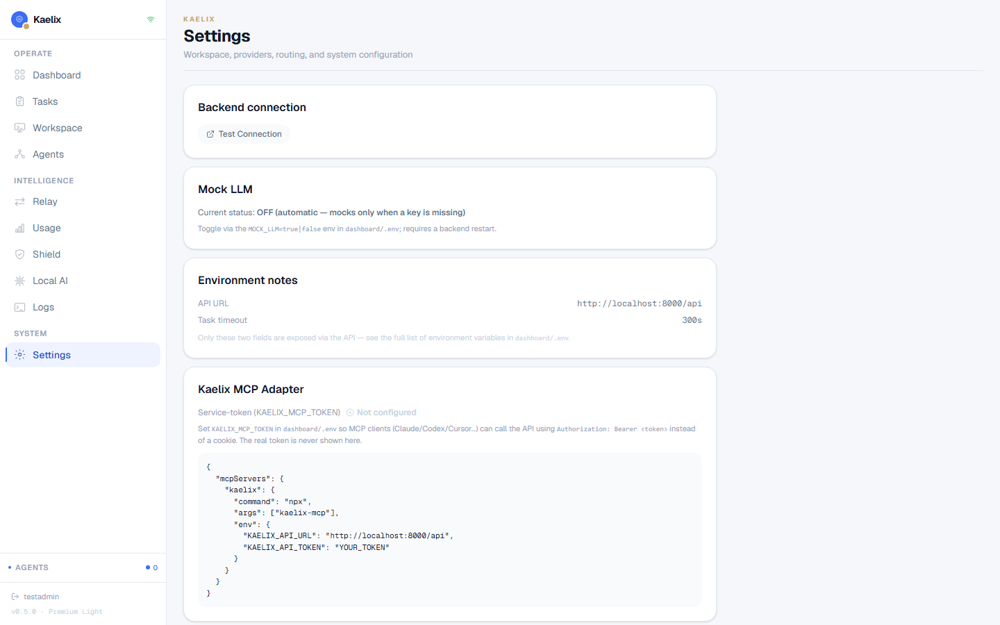

# Kaelix MCP Adapter

[](https://github.com/shadowhunter67/kaelix-mcp/actions/workflows/ci.yml)
[](https://www.npmjs.com/package/kaelix-mcp)
[](LICENSE)
[](package.json)

Kaelix MCP Adapter lets Claude, Codex, Cursor, and other MCP clients control a
self-hosted Kaelix Dashboard instance through MCP tools.

This repository contains only the public MCP adapter. It does not include the
Kaelix dashboard frontend, backend, database, prompts, credentials, or private
business logic. Users run their own dashboard and point this adapter at their
own local or self-hosted Kaelix API.

## Project Status

This is a personal project and an early public MCP adapter for Kaelix. It is
usable for testing, but the dashboard API contract and tool surface may still
change. Bug reports, setup feedback, and pull requests are welcome.

Current release:

- npm package: `kaelix-mcp`
- latest version: see the npm version badge above
- license: MIT
- runtime: Node.js 22.6 or newer

## What It Does

The adapter exposes Kaelix Dashboard actions as MCP tools:

- Read agents and tasks.
- Create, run, approve, and reject tasks.
- Check provider health.
- Check local AI / Ollama status when the dashboard supports it.
- Return structured, agent-friendly errors instead of raw backend failures.

Write tools can change dashboard state. MCP clients and users should treat this
adapter like an automation client with real side effects.

## Production Readiness

The adapter itself implements the guardrails that are entirely within its
control: SSRF/TLS validation of `KAELIX_API_URL` and redirect targets, strict
timeout parsing, response schema validation with size limits and truncation,
secret redaction, `isError`-tagged MCP failures, a code-enforced confirmation
check before approve/reject (`expectedRevision`, atomic against a backend
that supports it, or `expectedStatus` as a non-atomic fallback), and
capability discovery for optional endpoints. See "Security Model & Trust
Boundaries" below.

**This does not make the end-to-end system production-ready on its own** — the
rest depends on the Kaelix Dashboard backend actually deployed. A backend
that implements scoped, expiring, revocable service tokens (issued
out-of-band, not by this adapter) and backend-enforced revision checking
(`?expected_revision=` on approve/reject, atomic `409` on a stale write)
closes the corresponding gaps end-to-end; a backend that doesn't yet does
not. As of adapter 0.3.0, `kaelix_approve_task`/`kaelix_reject_task` send
`expected_revision` when the caller supplies it (read via
`kaelix_get_task`'s `revision` field) whenever the backend accepts it — this
adapter repo does not ship or document any particular backend's current
state; verify the specific instance you're pointing at.

Not implemented anywhere as of this adapter version, regardless of backend:

- Rate limiting: the adapter maps HTTP `429` responses to a `rate_limit`
  error and honors `Retry-After` on retryable requests, but it cannot verify
  whether a given backend deployment actually enforces rate limits — confirm
  that separately, especially if the backend runs multiple worker processes
  (a per-process in-memory limiter would not be shared across workers).
- Server-side pagination for `GET /agents` and `GET /tasks` — the adapter
  self-limits and reports truncation client-side today.

Do not assume production-readiness from this README alone — verify the
backend you're pointing at actually has scoped tokens and revision-based
concurrency deployed, not just documented as supported somewhere.

## Screenshots

The MCP adapter is designed to control a self-hosted Kaelix Dashboard instance
like the one below.


| Agents                                        | Tasks                                       |
| --------------------------------------------- | ------------------------------------------- |
|  |  |

| Relay cockpit                               | Local AI                                          |
| ------------------------------------------- | ------------------------------------------------- |
|  |  |



## Requirements

- Node.js 22.6 or newer (see the CI matrix for the exact versions tested:
  22.x and 24.x).
- A running Kaelix Dashboard backend, usually `http://localhost:8000/api`.
- A dashboard service token set in `KAELIX_API_TOKEN`.

The recommended auth mode is Bearer service-token auth:

```env
KAELIX_API_URL=http://localhost:8000/api
KAELIX_API_TOKEN=replace-with-service-token
```

Cookie auth exists only as a local development fallback. It requires **both**
`KAELIX_ALLOW_COOKIE_AUTH=true` and `KAELIX_SESSION_COOKIE` — setting only one
of the two is a startup configuration error, not a silent partial-auth state:

```env
KAELIX_ALLOW_COOKIE_AUTH=true
KAELIX_SESSION_COOKIE=kaelix_session=...
```

If both `KAELIX_API_TOKEN` and cookie auth are configured, the adapter always
uses the bearer token and never attaches the cookie, on every request
(including after a same-origin redirect).

Do not use cookie auth on shared machines, CI, remote MCP servers, synced config
folders, or public examples. Never publish real tokens or cookies. When cookie
auth is enabled without `KAELIX_API_TOKEN`, the adapter writes a warning to
stderr at startup.

### All environment variables

| Variable                       | Default                        | Notes                                                                                                                          |
| ------------------------------ | ------------------------------ | ------------------------------------------------------------------------------------------------------------------------------ |
| `KAELIX_API_URL`               | `http://localhost:8000/api`    | Must be `https://` unless the host is loopback (`localhost`, `127.0.0.0/8`, `::1`). Rejects embedded `user:pass@` credentials. |
| `KAELIX_API_TOKEN`             | unset                          | Bearer service token. Recommended for all non-local use.                                                                       |
| `KAELIX_ALLOW_COOKIE_AUTH`     | `false`                        | Must be `true` together with `KAELIX_SESSION_COOKIE`, or startup fails. Local dev only.                                        |
| `KAELIX_SESSION_COOKIE`        | unset                          | Ignored unless `KAELIX_ALLOW_COOKIE_AUTH=true`. Never attached when `KAELIX_API_TOKEN` is set.                                 |
| `KAELIX_TIMEOUT_MS`            | `20000`                        | Must be a bare integer in `[1000, 120000]`. Anything else (`abc`, `NaN`, decimals, negative, `0`, out of range) fails fast.    |
| `KAELIX_ALLOWED_HOSTS`         | unset (no extra restriction)   | Comma-separated hostname allowlist for non-loopback `KAELIX_API_URL`/redirect targets. Loopback is always allowed.             |
| `KAELIX_ENABLE_LOCAL_AI_TOOLS` | unset (`auto`, probes startup) | `on` always registers `kaelix_local_ai_*` tools, `off` never does, unset probes `/local-ai/status` once at startup.            |

For internal/self-signed HTTPS endpoints, set Node's standard
`NODE_EXTRA_CA_CERTS=/path/to/ca.pem` environment variable when launching the
adapter — this is the supported way to trust a custom CA, rather than a
Kaelix-specific option that would duplicate Node's own TLS trust store
handling.

## Quick Start

Use the published npm package from an MCP client:

```json
{
  "mcpServers": {
    "kaelix": {
      "command": "npx",
      "args": ["-y", "kaelix-mcp"],
      "env": {
        "KAELIX_API_URL": "http://localhost:8000/api",
        "KAELIX_API_TOKEN": "replace-with-service-token"
      }
    }
  }
}
```

Then restart your MCP client and ask it to call `kaelix_server_info` first. That
tool confirms the adapter can read its config and shows which auth mode is
active without exposing secrets.

## Client Examples

Example config files are included in:

- `examples/claude-desktop.json`
- `examples/cursor.json`
- `examples/codex.toml` (Codex CLI uses TOML at `~/.codex/config.toml`, not JSON)

Most MCP clients use the same shape:

```json
{
  "mcpServers": {
    "kaelix": {
      "command": "npx",
      "args": ["-y", "kaelix-mcp"],
      "env": {
        "KAELIX_API_URL": "http://localhost:8000/api",
        "KAELIX_API_TOKEN": "replace-with-service-token"
      }
    }
  }
}
```

For local adapter development, run the built file directly:

```json
{
  "mcpServers": {
    "kaelix": {
      "command": "node",
      "args": ["/absolute/path/to/kaelix-mcp/dist/index.js"],
      "env": {
        "KAELIX_API_URL": "http://localhost:8000/api",
        "KAELIX_API_TOKEN": "replace-with-service-token"
      }
    }
  }
}
```

## Architecture

```text
MCP client
  -> npx kaelix-mcp
  -> KAELIX_API_URL
  -> self-hosted Kaelix Dashboard backend
```

The adapter talks to the dashboard HTTP API. It does not host a server, store a
database, or call AI providers directly.

## Tools

| Tool                          | Purpose                                             | Side effect |
| ----------------------------- | --------------------------------------------------- | ----------- |
| `kaelix_server_info`          | Show adapter config and auth mode                   | No          |
| `kaelix_capabilities`         | Show which optional capabilities were detected      | No          |
| `kaelix_list_agents`          | List dashboard agents (capped, truncation reported) | No          |
| `kaelix_list_tasks`           | List tasks (capped, truncation reported)            | No          |
| `kaelix_get_task`             | Get one task, including logs/runs                   | No          |
| `kaelix_create_task`          | Create a pending task                               | Yes         |
| `kaelix_run_task`             | Queue task execution                                | Yes         |
| `kaelix_approve_task`         | Approve reviewed task output                        | Yes         |
| `kaelix_reject_task`          | Reject reviewed task output                         | Yes         |
| `kaelix_provider_health`      | Read provider health and cooldown status            | No          |
| `kaelix_local_ai_status`\*    | Check local AI / Ollama status                      | No          |
| `kaelix_local_ai_models`\*    | List local AI models                                | No          |
| `kaelix_local_ai_test_chat`\* | Send a short local model test prompt                | Yes         |

\* Only registered if the startup capability probe confirms the dashboard
backend exposes `/local-ai/*` (or `KAELIX_ENABLE_LOCAL_AI_TOOLS=on` forces
it). See "Capability Discovery".

Task write tools support guardrail fields where relevant:

- `kaelix_create_task` / `kaelix_run_task`: support `dryRun` (preview only,
  no backend call) and `idempotencyKey` (forwarded as `Idempotency-Key`).
- `kaelix_approve_task` / `kaelix_reject_task`: **require** `expectedStatus`
  — the task status you last observed (e.g. via `kaelix_get_task`). The
  adapter re-reads the task immediately before mutating it and fails with a
  `conflict` error if the live status no longer matches, instead of relying
  only on the tool description to stop unintended approvals. This is a
  best-effort confirmation boundary, not atomic concurrency — see "Known
  Limitations".

## Tool Contract For AI Agents

Use this order when possible:

1. Call `kaelix_server_info` (and optionally `kaelix_capabilities`) to
   confirm config before doing anything else.
2. Call read-only tools before write tools.
3. Use `dryRun: true` before `kaelix_create_task` or `kaelix_run_task` when the
   user has not clearly approved the action.
4. Use `idempotencyKey` for task creation and execution if the client may retry.
5. Before `kaelix_approve_task`/`kaelix_reject_task`, call `kaelix_get_task`
   first and pass its `status` back as `expectedStatus`.
6. Ask for human confirmation before running, approving, or rejecting important
   tasks.
7. Never expose `KAELIX_API_TOKEN`, `KAELIX_SESSION_COOKIE`, or backend secrets
   in responses. The adapter redacts secret-shaped strings from its own
   output as defense in depth, but do not rely on that as the only control.

All tool responses are JSON text wrapped in an envelope, and the MCP
`isError` flag is set on failures so it cannot be mistaken for success by a
client or telemetry pipeline that only inspects the flag:

```json
{
  "ok": true,
  "correlationId": "b3f6b6de-...-9b0e",
  "data": { "...": "validated, redacted backend response" }
}
```

```json
{
  "ok": false,
  "correlationId": "b3f6b6de-...-9b0e",
  "error": {
    "kind": "auth",
    "status": 401,
    "path": "/tasks",
    "message": "Kaelix API returned 401 Unauthorized."
  }
}
```

`correlationId` is a random UUID generated per tool call (not derived from any
request data) purely to correlate a tool result with adapter-side stderr
audit lines; it carries no sensitive information.

Possible `error.kind` values:

- `auth` — 401, missing/invalid credentials.
- `forbidden` — 403, authenticated but not permitted.
- `not_found` — 404.
- `conflict` — 409, or the adapter's own `expectedStatus` mismatch.
- `validation` — 400/422, or the backend response failed schema validation.
- `timeout` — request exceeded `KAELIX_TIMEOUT_MS`.
- `rate_limit` — 429 (the adapter respects `Retry-After` when retrying safe
  `GET`/`HEAD` requests; it never auto-retries writes).
- `network` — could not reach the backend, or a disallowed/invalid redirect.
- `backend` — 5xx or an unclassified HTTP status.
- `parse` — non-JSON success response.
- `response_too_large` — response body exceeded the adapter's byte cap.
- `capability_unavailable` — reserved for capability-gated tools.
- `unexpected` — anything else (bug, unexpected exception shape).

## Response Validation, Pagination, And Redaction

Every backend response is validated against a typed schema before it reaches
the caller — a malformed or unexpectedly-shaped response is surfaced as a
`validation` error instead of being passed through untouched. List responses
(`kaelix_list_agents`, `kaelix_list_tasks`) are capped at 200 items and
returned as `{ items, truncated, originalSize, returnedSize }` so a large
dashboard cannot silently blow past the response budget. Any single response
body over 2 MiB is rejected as `response_too_large` rather than buffered in
full. Every tool response — success or error — is redacted for
token/cookie/authorization-shaped strings before serialization.

## Capability Discovery

Local-AI tools (`kaelix_local_ai_*`) call `/api/local-ai/*`, which only exists
on newer Kaelix Dashboard backends. Registering them unconditionally would
mean older backends return a confusing 404 for a tool the client has no way
to know is unsupported. At startup the adapter probes `/local-ai/status` once
(short timeout, process-lifetime cache): a `404` disables the tools, a
successful response enables them, and any other failure (network/timeout/5xx)
fails safe by disabling them rather than guessing. Set
`KAELIX_ENABLE_LOCAL_AI_TOOLS=on`/`off` to skip the probe and force the
outcome. Call `kaelix_capabilities` at any time to see what was detected.

## Known Limitations

**A backend may implement (adapter 0.3.0 speaks this contract when present):**

- **Scoped, expiring, revocable service tokens** — issued out-of-band by the
  backend's own token-management UI/endpoint (not by this adapter), each
  scoped to specific actions (e.g. read-only vs. approve). Point
  `KAELIX_API_TOKEN` at an issued scoped token to get per-scope enforcement;
  a token missing a required scope gets a `403`, mapped to the adapter's
  `forbidden` error kind.
- **Atomic revision-conflict checking.** If the backend returns a `revision`
  field on tasks and accepts `?expected_revision=` on approve/reject, checked
  atomically in the same transaction as the write, `kaelix_approve_task`/
  `kaelix_reject_task` forward `expected_revision` when the caller supplies
  it (read via `kaelix_get_task`'s `revision` field) — a stale value fails
  with a real backend `409`, mapped to the adapter's `conflict` error kind.
  `expectedStatus` remains available as a non-atomic, adapter-side-only
  fallback for backends that don't send `revision`.
- **A durable, queryable audit trail for MCP-triggered writes** — if the
  backend exposes one, treat it as the source of truth; the adapter's own
  process-local stderr audit line (`kaelix_mcp_audit`) is useful for local
  debugging only and is not a substitute for a real backend-side log.

Whether a given Kaelix Dashboard deployment actually implements the above is
a property of that deployment, not of this adapter — verify it directly
against the instance you're pointing at (e.g. attempt an out-of-scope call
and confirm you get a real `403`, not a silently-ignored scope) rather than
assuming it from this README.

**Still not implemented anywhere as of this adapter version:**

- **No server-side pagination.** `GET /agents` and `GET /tasks` return the
  full table with no query params; the adapter's `limitList` cap is a
  client-side stopgap, not real pagination.
- **Rate limiting**: the adapter maps `429` to `rate_limit` and honors
  `Retry-After`, but cannot confirm a given backend actually enforces limits
  consistently — verify separately, especially across multiple backend
  worker processes.

Treat a Kaelix Dashboard + this adapter pairing as suitable for a single
trusted operator with scoped tokens once pagination lands and rate limiting
is confirmed deployed, not as a fully hardened zero-trust multi-tenant
system today.

## Backend API Contract

| Tool                        | Method | Backend path                | Auth     |
| --------------------------- | ------ | --------------------------- | -------- |
| `kaelix_list_agents`        | `GET`  | `/agents`                   | Required |
| `kaelix_list_tasks`         | `GET`  | `/tasks`                    | Required |
| `kaelix_get_task`           | `GET`  | `/tasks/:taskId`            | Required |
| `kaelix_create_task`        | `POST` | `/tasks`                    | Required |
| `kaelix_run_task`           | `POST` | `/tasks/:taskId/run`        | Required |
| `kaelix_approve_task`       | `POST` | `/tasks/:taskId/approve`    | Required |
| `kaelix_reject_task`        | `POST` | `/tasks/:taskId/reject`     | Required |
| `kaelix_provider_health`    | `GET`  | `/settings/provider-health` | Required |
| `kaelix_local_ai_status`    | `GET`  | `/local-ai/status`          | Required |
| `kaelix_local_ai_models`    | `GET`  | `/local-ai/models`          | Required |
| `kaelix_local_ai_test_chat` | `POST` | `/local-ai/test-chat`       | Required |

The `local_ai` tools require matching `/api/local-ai/*` endpoints in the
dashboard backend. If the user's dashboard version does not expose those
endpoints yet, the adapter returns a clear API error instead of crashing.

## Security Model & Trust Boundaries

- **The adapter trusts the MCP client** to only send tool calls the human
  user actually wants executed. It does not itself gate calls behind
  additional confirmation beyond the `expectedStatus` check on
  approve/reject and the `dryRun` preview on create/run — the calling client
  and the human in the loop are the primary trust boundary for "should this
  action happen."
- **The adapter does not trust the backend response body.** Every response
  is parsed against a schema before use; secrets in error bodies are
  redacted; oversized bodies are rejected rather than buffered.
- **The adapter does not trust redirect targets.** A redirect is re-validated
  against the same URL/host rules as `KAELIX_API_URL`, and `Authorization`/
  `Cookie` are stripped whenever the redirect crosses origin.
- **The backend is the only real authorization boundary today**, and (see
  "Known Limitations") it currently grants one undifferentiated
  "mcp-service" identity full access on token match — there is no scope
  separation between a client that should only read tasks and one that
  should approve them. Do not point this adapter at a Kaelix Dashboard
  shared with untrusted or semi-trusted MCP clients until scoped tokens
  land.
- **Loopback HTTP is intentionally allowed**; everything else must be HTTPS.
  This matches the default local-development target
  (`http://localhost:8000/api`) without weakening the rule for any real
  remote deployment.

## Backend Service Token

Kaelix Dashboard should expose service-token auth for MCP clients. Set this in
the dashboard backend `.env`:

```env
KAELIX_MCP_TOKEN=generated-secret
```

The adapter then sends:

```http
Authorization: Bearer generated-secret
```

The dashboard can expose a status endpoint that confirms whether MCP auth is
configured without returning the token:

```http
GET /api/auth/mcp-status
-> { "enabled": true, "auth_type": "bearer" }
```

Generate a token locally and never commit it:

```bash
python -c "import secrets; print(secrets.token_urlsafe(32))"
```

## Local Development

```bash
npm install
npm run build
npm test
```

Useful scripts:

```bash
npm run format:check
npm run lint
npm run typecheck
npm run build
npm test
npm audit --omit=dev
```

Test the published package metadata:

```bash
npm view kaelix-mcp version
```

Run the published package:

```bash
npx -y kaelix-mcp
```

The `npx` command starts an MCP server over stdio, so it may appear to wait for
client input. That is expected.

## Troubleshooting

`kaelix_server_info` shows `authMode: "none"`:

- Set `KAELIX_API_TOKEN`.
- Confirm the MCP client config restarted.

Tool returns `error.kind: "network"`:

- Confirm the dashboard backend is running.
- Check `KAELIX_API_URL`, usually `http://localhost:8000/api`.

Tool returns `error.kind: "auth"`:

- Confirm the dashboard backend has `KAELIX_MCP_TOKEN`.
- Confirm `KAELIX_API_TOKEN` matches that value.
- Avoid cookie auth unless this is local-only development.

Local AI tools return `not_found`:

- Your dashboard build may not include `/api/local-ai/*` yet.
- Update the dashboard backend or use non-local-AI tools first.

## Open-Source Boundary

Recommended split:

```text
kaelix-dashboard/   private or community dashboard
kaelix-mcp/         public MCP adapter
```

The public adapter should contain API contracts, tool definitions, examples,
tests, and docs. It should not contain private dashboard internals.

## CI/CD And Release

This repository has two GitHub Actions workflows:

- `CI`: runs on pushes and pull requests to `main`, across a Node 22.x/24.x
  matrix. Every step is a required quality gate — none use
  `continue-on-error`, so any failing step (format, lint, typecheck, build,
  test, `npm audit --omit=dev`, or `npm pack --dry-run`) fails the run.
- `Release`: re-runs the full quality gate (including lint and audit) before
  packing, uploads the tarball as a checkable artifact, and only publishes to
  npm when a GitHub Release is published or the workflow is dispatched with
  `publish_npm: true`.

The release pipeline runs:

```bash
npm ci
npm run format:check
npm run lint
npm run typecheck
npm run build
npm test
npm run test:integration
npm audit --omit=dev
npm pack
```

Publishing uses npm provenance:

```bash
npm publish --provenance --access public
```

Requirements for publishing:

- The GitHub repository and npm package must be public for provenance.
- npm Trusted Publisher must authorize the GitHub Actions workflow in
  `.github/workflows/release.yml` with the `npm publish` permission.
- The publish job must have `id-token: write`; no npm access token is stored in
  GitHub Actions.
- Package publishing access disallows tokens, so releases can only publish
  through the configured OIDC trust or an interactive npm account with 2FA.

## Public Release Checklist

- [x] Add backend service-token support (single bearer token; see "Known
      Limitations" for what scoped-token support still needs).
- [x] Confirm every tool maps to a dashboard API endpoint.
- [x] Add screenshots to the public README.
- [x] Add CI for format, lint, typecheck, build, tests, `npm audit`, and
      `npm pack --dry-run`, across a Node 22.x/24.x matrix.
- [x] Add release workflow with npm package artifact and the same quality
      gates as CI.
- [x] Configure npm OIDC trusted publishing with provenance and publish
      `kaelix-mcp` without a stored npm token.
- [x] Keep `.env`, tokens, cookies, and dashboard databases out of the repo
      (verified via `npm pack --dry-run` tarball contents).
- [x] SSRF/TLS validation for `KAELIX_API_URL` and redirect targets.
- [x] Response schema validation, size limits, truncation, and secret
      redaction on every tool response.
- [x] `isError`-tagged MCP failures with a normalized error taxonomy.
- [x] Capability discovery for optional (`local-ai`) endpoints.
- [x] Adapter-side support for backend-enforced scoped tokens, atomic
      optimistic concurrency (`expected_revision`/409), and an MCP audit
      log — the adapter (0.3.0) speaks this contract via `expectedRevision`
      on approve/reject whenever a backend implements it; whether a given
      deployment actually does is that deployment's property, not this
      adapter's (verify directly against the instance you're using).
- [ ] Backend rate limiting (per-token/IP, 429 + `Retry-After`) — adapter
      maps `429` to `rate_limit` and honors `Retry-After` already,
      not yet verified end-to-end against a rate-limited backend.
