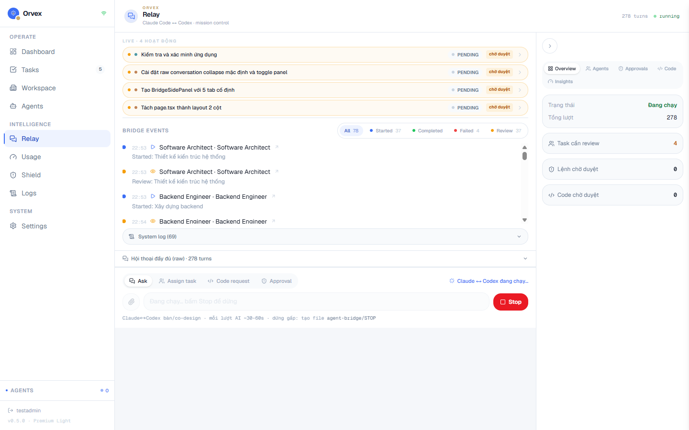
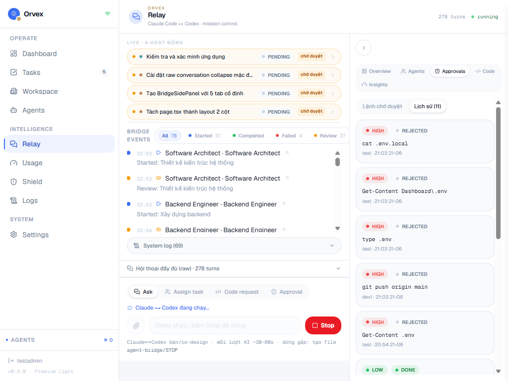
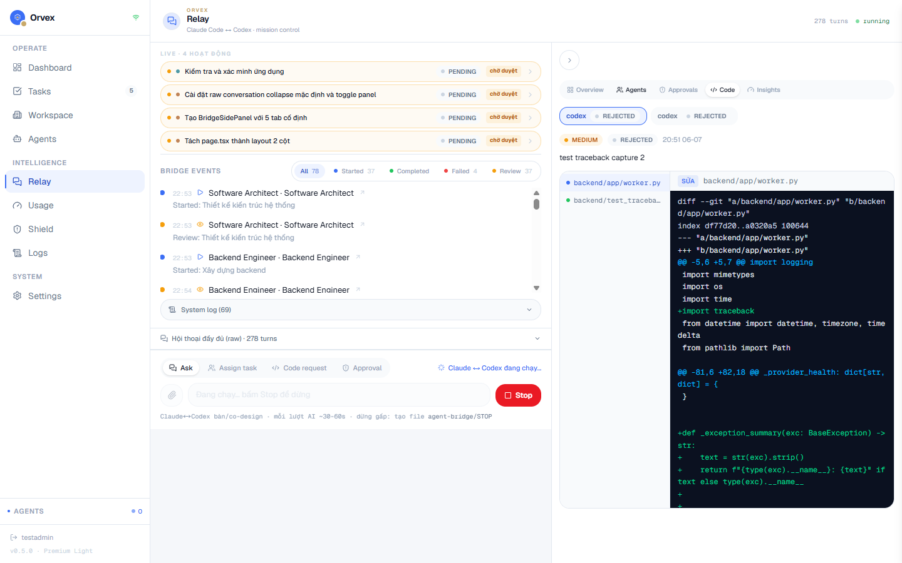
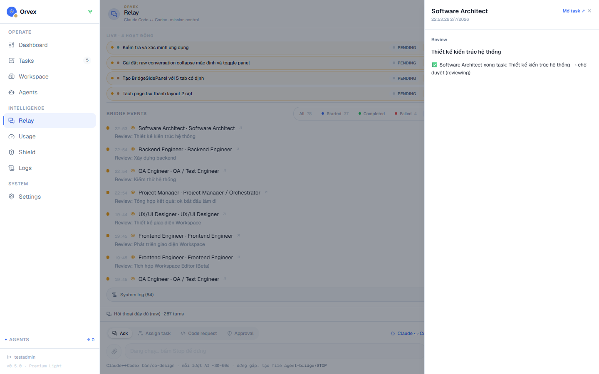

# Kaelix MCP Adapter

[](LICENSE)

Kaelix MCP Adapter lets Claude, Codex, Cursor, and other MCP clients control a
self-hosted Kaelix Dashboard instance through tools.

## Project Status

This is a personal project and an early MCP adapter for Kaelix. It is under
active development, so tools, API contracts, and setup steps may change. Public
testing, bug reports, and feedback are welcome.

This adapter is intentionally small and safe to open-source. It does not include
the Kaelix dashboard frontend, backend, database, prompts, or private business
logic. It only calls the Kaelix HTTP API configured by the user.

## Screenshots

The MCP adapter is designed to control a self-hosted Kaelix Dashboard instance
like the one below. Screenshots may show an earlier dashboard theme while the
Kaelix rename is still in progress.



| Approvals | Code review |
| --- | --- |
|  |  |



## Architecture

```text
MCP client
  -> kaelix-mcp
  -> KAELIX_API_URL
  -> self-hosted Kaelix Dashboard backend
```

## Requirements

- Node.js 22.6 or newer
- A running Kaelix backend, usually `http://localhost:8000/api`
- Auth for that backend:
  - preferred: `KAELIX_API_TOKEN` service-token auth
  - temporary local fallback only: `KAELIX_SESSION_COOKIE`
- Optional timeout override: `KAELIX_TIMEOUT_MS` defaults to `20000`

> `KAELIX_SESSION_COOKIE` is for local development only. Do not use cookie auth
> on shared machines, remote MCP servers, CI, synced config folders, or public
> examples.

## Install For Local Development

```bash
cd MCP
npm install
npm run build
npm test
```

## MCP Client Config

Use this from the root of the Kaelix dashboard repo during development. Replace
`/absolute/path/to/kaelix` with the path on the user's machine:

```json
{
  "mcpServers": {
    "kaelix": {
      "command": "node",
      "args": ["/absolute/path/to/kaelix/MCP/dist/index.js"],
      "env": {
        "KAELIX_API_URL": "http://localhost:8000/api",
        "KAELIX_API_TOKEN": "replace-with-service-token"
      }
    }
  }
}
```

If the dashboard still uses only cookie login, use a local-only cookie fallback:

```json
{
  "mcpServers": {
    "kaelix": {
      "command": "node",
      "args": ["/absolute/path/to/kaelix/MCP/dist/index.js"],
      "env": {
        "KAELIX_API_URL": "http://localhost:8000/api",
        "KAELIX_SESSION_COOKIE": "kaelix_session=..."
      }
    }
  }
}
```

Do not publish real tokens or session cookies.

After publishing this package to npm, users can use `npx` instead:

```json
{
  "mcpServers": {
    "kaelix": {
      "command": "npx",
      "args": ["kaelix-mcp"],
      "env": {
        "KAELIX_API_URL": "http://localhost:8000/api",
        "KAELIX_API_TOKEN": "replace-with-service-token"
      }
    }
  }
}
```

## Tools

- `kaelix_server_info`: show adapter configuration and auth mode.
- `kaelix_list_agents`: list dashboard agents.
- `kaelix_list_tasks`: list tasks.
- `kaelix_get_task`: get one task by id.
- `kaelix_create_task`: create a pending task. This writes to the dashboard database.
- `kaelix_run_task`: enqueue a task. This can trigger model/tool activity through the dashboard backend.
- `kaelix_approve_task`: approve a reviewing task after output inspection.
- `kaelix_reject_task`: reject a reviewing task.
- `kaelix_provider_health`: get provider health and cooldown state.
- `kaelix_local_ai_status`: check Ollama/local AI status if the dashboard exposes it.
- `kaelix_local_ai_models`: list local models if the dashboard exposes it.
- `kaelix_local_ai_test_chat`: send a short local model test prompt if supported.

Tool errors are returned as MCP-friendly JSON with `ok: false`, `error.kind`,
`error.status`, `error.path`, and a short message.

The `local_ai` tools require matching `/api/local-ai/*` endpoints in the
dashboard backend. Keep them in the adapter so the public MCP contract is ready,
but expect them to fail with a clear API error until those backend endpoints
exist.

## API Contract

| Tool | Method | Backend path | Auth | Side effect |
| --- | --- | --- | --- | --- |
| `kaelix_list_agents` | `GET` | `/agents` | Required | No |
| `kaelix_list_tasks` | `GET` | `/tasks` | Required | No |
| `kaelix_get_task` | `GET` | `/tasks/:taskId` | Required | No |
| `kaelix_create_task` | `POST` | `/tasks` | Required | Creates a pending task |
| `kaelix_run_task` | `POST` | `/tasks/:taskId/run` | Required | Queues task execution |
| `kaelix_approve_task` | `POST` | `/tasks/:taskId/approve` | Required | Approves reviewed output |
| `kaelix_reject_task` | `POST` | `/tasks/:taskId/reject` | Required | Rejects reviewed output |
| `kaelix_provider_health` | `GET` | `/settings/provider-health` | Required | No |
| `kaelix_local_ai_status` | `GET` | `/local-ai/status` | Required | No |
| `kaelix_local_ai_models` | `GET` | `/local-ai/models` | Required | No |
| `kaelix_local_ai_test_chat` | `POST` | `/local-ai/test-chat` | Required | Sends a local model test prompt |

## Backend Token Recommendation

For a polished public release, add a backend service-token auth path:

```env
KAELIX_MCP_TOKEN=generated-secret
```

Then allow requests with:

```http
Authorization: Bearer generated-secret
```

Only expose the minimal MCP-safe endpoints. Keep browser cookie auth for the web
dashboard.

## Open-Source Boundary

Recommended split:

```text
kaelix-dashboard/   private or community edition
kaelix-mcp/         public adapter
```

The public adapter should contain API contracts, tool definitions, docs, and
examples. It should not contain private dashboard internals.

## Public Release Checklist

- Add backend service-token support.
- Confirm every tool maps to a stable dashboard API endpoint.
- Add screenshots or short GIFs to the public README.
- Publish as `kaelix-mcp` or a scoped package such as `@kaelix/mcp`.
- Keep `.env`, tokens, cookies, and dashboard databases out of the repo.
